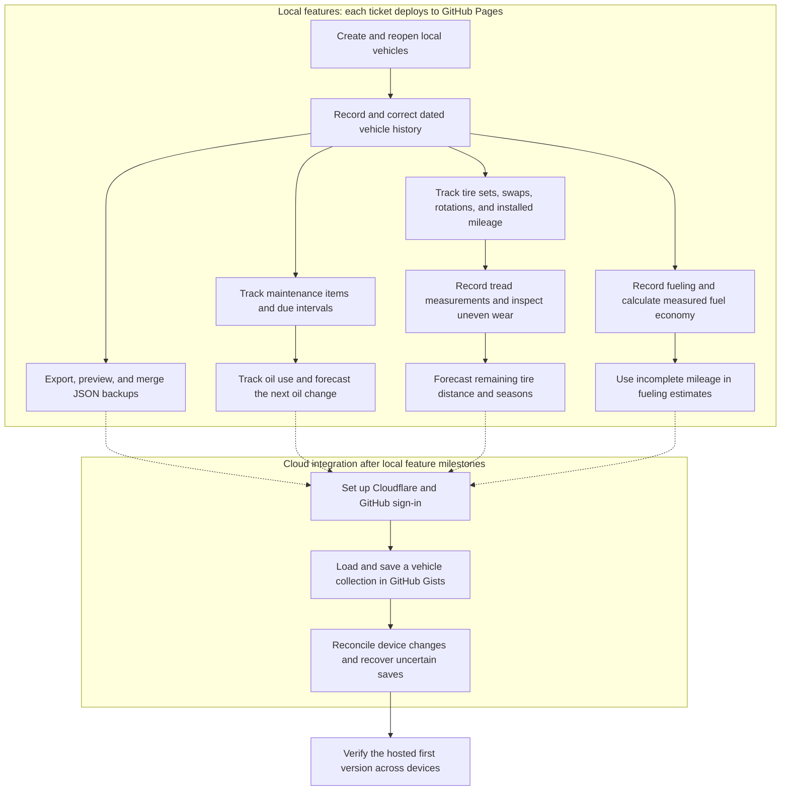

# First usable version: approved implementation tickets

Status: approved — tickets published ready-for-agent

**Source:** [CarMaintenanceTracker implementation specification](../first-usable-version/spec.md).

This approved breakdown contains 14 complete implementation slices, 155 acceptance criteria, and coverage of all 68 user stories. Each ticket has independent behavior, dependency links, acceptance checks, and context for a fresh implementation session. The source spec and closed wayfinder decisions are unchanged.

## Delivery decisions added during ticket review

The user requires the app to be pushed to GitHub after each ticket so features can be tested as development progresses, and has moved authentication/Gist integration to the end of feature development.

- **Phase 1: local features.** Complete and deploy the local vehicle/history, maintenance, JSON backup, oil, tire, and fueling slices first. The published GitHub Pages app saves to the current browser's IndexedDB; it does not require GitHub sign-in or the Worker.
- **Phase 2: cloud integration.** After the local feature milestones are live, set up Cloudflare/GitHub sign-in, then Gist load/save, then cross-device reconciliation.
- **Final verification.** Verify the integrated first version; this is not the first opportunity for the user to try the app.
- **Every ticket ships.** Passing tests or pushing a feature branch is insufficient: integrate through the repository workflow into the actual Pages publishing branch, commit/push, wait for deployment, verify the live app, and provide the deployed commit plus short testing steps.
- **Preserve early test data.** Earlier released records must remain usable. Test non-destructive schema migrations when needed; do not reset browser storage or identities as an upgrade shortcut.
- **Deploy serially.** Independent code work may happen in parallel, but integrate and publish completed tickets one at a time so each release is verified. Do not wait for a full-spec integration branch to finish before publishing features.
- **Local versus shared data.** Before Gist support, each browser/device has its own data. JSON export/import supplies manual transfer once delivered. Deployment on GitHub Pages does not itself centralize the vehicle data.

The first ticket verifies/establishes the actual Pages publishing source and deployment path. The live app is [CarMaintenanceTracker](https://jpconstantineau.github.io/CarMaintenanceTracker/). Deploy a compatible Worker when auth code changes; normal local-feature releases do not require the Worker.

## Approved breakdown

1. **[Create and reopen local vehicles](issues/01-create-and-reopen-vehicles.md)**
   - **Blocked by:** None (can start immediately).
   - **Delivers:** Create or select a personal vehicle, edit its identifying information, and reopen it with local data intact. Establish the module and persistence contracts through this usable flow, replacing the scaffold's transient vehicle list.

2. **[Record and correct dated vehicle history](issues/02-record-and-correct-history.md)**
   - **Blocked by:** [Create and reopen local vehicles](issues/01-create-and-reopen-vehicles.md)
   - **Delivers:** Record odometer readings and general observations, enter several dated records together, inspect the vehicle history, and correct or remove old entries without losing unknowns or chronology.

3. **[Track maintenance items and due intervals](issues/03-maintenance-items-and-due-intervals.md)**
   - **Blocked by:** [Record and correct dated vehicle history](issues/02-record-and-correct-history.md)
   - **Delivers:** Configure maintenance items for each vehicle, retain replacement information and completed work, and see distance/time-based due status with drill-down to its supporting history.

4. **[Export, preview, and merge JSON backups](issues/04-json-backup-and-merge.md)**
   - **Blocked by:** [Record and correct dated vehicle history](issues/02-record-and-correct-history.md)
   - **Delivers:** Export a portable collection, import an app JSON file with a reviewable merge, and restore a collection through a separate recoverable replacement action.

5. **[Track oil use and forecast the next oil change](issues/05-oil-history-and-forecasts.md)**
   - **Blocked by:** [Track maintenance items and due intervals](issues/03-maintenance-items-and-due-intervals.md)
   - **Delivers:** Record oil changes, life percentages, level checks, and top-ups; inspect achieved oil-change distances; and see supported 0%-life and calendar forecasts.

6. **[Track tire sets, swaps, rotations, and installed mileage](issues/06-tire-placement-and-seasonal-mileage.md)**
   - **Blocked by:** [Record and correct dated vehicle history](issues/02-record-and-correct-history.md)
   - **Delivers:** Create recognizable individual tires and sets, record their placement through seasonal swaps and rotations, and inspect time and distance at each position.

7. **[Record tread measurements and inspect uneven wear](issues/07-tread-measurements-and-wear-history.md)**
   - **Blocked by:** [Track tire sets, swaps, rotations, and installed mileage](issues/06-tire-placement-and-seasonal-mileage.md)
   - **Delivers:** Enter full or partial eight-point tread sessions in the gauge's units, inspect inner/outer wear history, and configure the tire's visible tread threshold.

8. **[Forecast remaining tire distance and seasons](issues/08-tire-life-forecasts.md)**
   - **Blocked by:** [Record tread measurements and inspect uneven wear](issues/07-tread-measurements-and-wear-history.md)
   - **Delivers:** Show each tire's limiting-edge and whole-average remaining-distance forecasts, explain uneven-wear differences, and provide seasonal estimates only when supported.

9. **[Record fueling and calculate measured fuel economy](issues/09-fueling-and-measured-economy.md)**
   - **Blocked by:** [Record and correct dated vehicle history](issues/02-record-and-correct-history.md)
   - **Delivers:** Record dated fuel additions with full/partial/unknown status and optional mileage, then see recent/overall economy from complete periods and distance represented by added fuel.

10. **[Use incomplete mileage in fueling estimates](issues/10-fuel-economy-with-estimated-mileage.md)**
   - **Blocked by:** [Record fueling and calculate measured fuel economy](issues/09-fueling-and-measured-economy.md)
   - **Delivers:** Use suitable odometer observations from the whole vehicle history to estimate missing fueling mileage and extend fuel-economy calculations without changing the recorded facts.

11. **[Set up Cloudflare and GitHub sign-in](issues/11-cloudflare-github-sign-in.md)**
   - **Blocked by:** [Export, preview, and merge JSON backups](issues/04-json-backup-and-merge.md), [Track oil use and forecast the next oil change](issues/05-oil-history-and-forecasts.md), [Forecast remaining tire distance and seasons](issues/08-tire-life-forecasts.md), [Use incomplete mileage in fueling estimates](issues/10-fuel-economy-with-estimated-mileage.md)
   - **Dependency meaning:** User-requested release-order gate after the local feature milestones; these are not claimed OAuth code dependencies.
   - **Delivers:** Guide the owner through necessary Cloudflare/GitHub account steps, configure and deploy the authentication Worker and GitHub OAuth application, and complete a real session-only sign-in from the GitHub Pages frontend.
   - **Human participation:** Account access/verification, GitHub authorization, and protected credential entry; agent prepares the code, configuration, deployment workflow, and tests.

12. **[Load and save a vehicle collection in GitHub Gists](issues/12-load-and-save-gist.md)**
   - **Blocked by:** [Set up Cloudflare and GitHub sign-in](issues/11-cloudflare-github-sign-in.md)
   - **Delivers:** Use the signed-in account to select/create one secret Gist for all vehicles, explicitly load and save it, and see which snapshot is saved locally versus on GitHub.

13. **[Reconcile device changes and recover uncertain saves](issues/13-cross-device-reconciliation-and-recovery.md)**
   - **Blocked by:** [Load and save a vehicle collection in GitHub Gists](issues/12-load-and-save-gist.md)
   - **Delivers:** Combine independent phone/desktop changes, resolve conflicting edits with both versions visible, and recover work after failed or uncertain cloud operations.

14. **[Verify the hosted first version across devices](issues/14-verify-hosted-first-version.md)**
   - **Blocked by:** [Reconcile device changes and recover uncertain saves](issues/13-cross-device-reconciliation-and-recovery.md)
   - **Delivers:** Deliver a verified hosted first version with complete vehicle summaries, usable phone/desktop workflows, working real GitHub access, and documented setup/recovery procedures.
   - **Human participation:** Real GitHub consent/test-account access as needed; provider account setup is already owned by the sign-in ticket.

## Dependency graph

Solid arrows are feature prerequisites. Dotted arrows enforce the user's local-features-first release order.

## Why these dependencies

- Local vehicles establishes the collection, UI/module contracts, persistence, tests, and verified deployment path through a complete usable flow.
- Dated history supplies chronology, unknowns, stable identities/deletions, and shared mileage evidence for maintenance, JSON, tire placement, and fueling.
- Oil depends on general maintenance's qualifying-service/item contract. Tires and fueling do not depend on oil or each other.
- Tire forecasts need placement distances and measured summaries. Fuel interpolation extends an already useful measured-economy flow.
- Cloud setup's four direct blockers are the completed local phase's leaves: JSON backup, oil, tire forecasting, and fueling estimates. They intentionally encode the requested release order, preventing a parallel implementer from starting cloud setup as soon as the shell exists.
- Gist load/save technically uses JSON and sign-in; JSON is already transitive through the phase gate, so it is not repeated as a redundant edge.
- Reconciliation follows working Gist operations. Final verification follows reconciliation, with every local feature already included transitively.
- Every slice includes its own tests and live deployment. The last ticket verifies complete integration and final operating/recovery guidance.

## Coverage and ownership

| Draft ticket | Primary/related user stories |
| --- | --- |
| [Create and reopen local vehicles](issues/01-create-and-reopen-vehicles.md) | 1, 2, 3, 4, 7, 51, 52, 68 |
| [Record and correct dated vehicle history](issues/02-record-and-correct-history.md) | 5, 6, 8, 9, 10, 11, 12, 13, 14, 15, 43, 49 |
| [Track maintenance items and due intervals](issues/03-maintenance-items-and-due-intervals.md) | 5, 6, 15, 16, 17, 18, 19, 20 |
| [Export, preview, and merge JSON backups](issues/04-json-backup-and-merge.md) | 53, 54, 55, 56, 64 |
| [Track oil use and forecast the next oil change](issues/05-oil-history-and-forecasts.md) | 21, 22, 23, 24, 25, 26, 49, 50 |
| [Track tire sets, swaps, rotations, and installed mileage](issues/06-tire-placement-and-seasonal-mileage.md) | 27, 28, 29, 30, 31, 32 |
| [Record tread measurements and inspect uneven wear](issues/07-tread-measurements-and-wear-history.md) | 33, 34, 35, 36, 40, 49, 50 |
| [Forecast remaining tire distance and seasons](issues/08-tire-life-forecasts.md) | 37, 38, 39, 40, 49, 50 |
| [Record fueling and calculate measured fuel economy](issues/09-fueling-and-measured-economy.md) | 41, 42, 43, 46, 47, 48, 49 |
| [Use incomplete mileage in fueling estimates](issues/10-fuel-economy-with-estimated-mileage.md) | 44, 45, 49 |
| [Set up Cloudflare and GitHub sign-in](issues/11-cloudflare-github-sign-in.md) | 57, 63, 64, 65, 67 |
| [Load and save a vehicle collection in GitHub Gists](issues/12-load-and-save-gist.md) | 58, 59, 62, 63, 66 |
| [Reconcile device changes and recover uncertain saves](issues/13-cross-device-reconciliation-and-recovery.md) | 59, 60, 61, 62, 63, 66 |
| [Verify the hosted first version across devices](issues/14-verify-hosted-first-version.md) | 5, 6, 7, 51, 52, 58, 59, 62, 63, 64, 65, 66, 67, 68 |

All 68 stories have at least one owner. Each relevant slice follows the four public module interfaces, typed validation, stable IDs, unknown/date/unit preservation, IndexedDB durability, meaningful tests, purposeful web design, and the per-ticket live-delivery criteria. New domain records extend the shared portable format and preserve data recorded against earlier deployments.

## Cloudflare and GitHub setup

[Set up Cloudflare and GitHub sign-in](issues/11-cloudflare-github-sign-in.md) includes account guidance, verification, OAuth registration, callback/origin configuration, Worker secret bindings, deployment, and real sign-in verification. Its human steps use the wizard skill where appropriate and remain part of the first-version project. They run after local feature development; none are executed while writing tickets.

[Load and save a vehicle collection in GitHub Gists](issues/12-load-and-save-gist.md) proves real Gist operations, and [Reconcile device changes and recover uncertain saves](issues/13-cross-device-reconciliation-and-recovery.md) completes shared-data behavior. The old wayfinder setup record was closed only because execution was outside planning, not because setup was completed or dropped.

## Approval and publication

The user approved the ticket breakdown on 2026-11-21 and requested that the tickets be marked ready for implementation. All 14 tickets are published as individual files in the issues directory with Status: ready-for-agent. Their dependencies, local-first release order, and per-ticket GitHub Pages delivery requirements remain unchanged.

Ticket 01 is the initial implementation frontier. Other tickets may start only after their listed blockers are complete. Approval and readiness do not mean implementation or deployment has already occurred. The source spec and closed wayfinder decisions remain unchanged.
